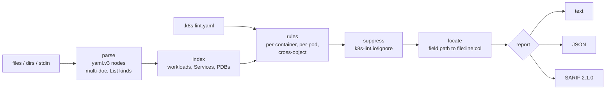

# k8s-manifest-lint

[](https://github.com/rahulkumar96t/k8s-manifest-lint/actions/workflows/ci.yml)

A small, fast linter for rendered Kubernetes manifests. Pipe it the output of
`helm template` or `kustomize build` in CI and it reports missing resource
requests and probes, mutable or unapproved images, risky security settings,
missing labels, and two mistakes that only show up across objects: replicated
workloads without a PodDisruptionBudget, and Services whose selector matches
nothing. Every finding carries a `file:line:column`, and reports come out as
text, JSON or SARIF 2.1.0 for GitHub code scanning. It is a single static Go
binary with one dependency (the YAML parser) and no Kubernetes client
libraries.

## Features

- Reads files, directories (recursive `*.yaml` / `*.yml`) and stdin;
  multi-document YAML and `List` kinds (`kind: List`, `DeploymentList`, ...).
- Checks Deployment, StatefulSet, DaemonSet, ReplicaSet, Job, CronJob and Pod,
  including init containers.
- 15 rules, each with an id, a default severity and a one-line rationale.
- Cross-object rules over the whole input: PDB coverage and Service selectors.
- `.k8s-lint.yaml` to enable/disable rules, change severities, and set the
  registry allow-list, required labels and required resources.
- Per-object suppression with the `k8s-lint.io/ignore` annotation.
- Text, JSON and SARIF 2.1.0 output; positions come from the YAML nodes.
- Exit codes for CI: `0` clean, `1` findings at or above `--fail-on`, `2`
  usage or parse error.
- A composite GitHub Action that builds or installs the binary, runs it and
  can upload SARIF to code scanning.

## Quickstart

```sh
go install github.com/rahulkumar96t/k8s-manifest-lint/cmd/k8s-manifest-lint@latest

k8s-manifest-lint examples/bad                       # a directory
helm template my-app ./chart | k8s-manifest-lint     # stdin
kustomize build overlays/prod | k8s-manifest-lint -f sarif -o lint.sarif
```

From a checkout: `go build -o bin/k8s-manifest-lint ./cmd/k8s-manifest-lint`.

Output for one of the bad examples (excerpt):

```text
$ k8s-manifest-lint -c examples/.k8s-lint.yaml examples/bad
examples/bad/api.yaml:12:3: warning pdb-required: 3 replicas but no PodDisruptionBudget in the input selects its pods (Deployment/shop/api)
examples/bad/api.yaml:22:11: warning liveness-probe: container "api" has no livenessProbe (Deployment/shop/api)
examples/bad/api.yaml:23:11: error image-registry: container "api" pulls "nginx:latest" from docker.io, which is not in allowedRegistries (Deployment/shop/api)
examples/bad/api.yaml:23:11: error image-tag: container "api" uses image "nginx:latest" with the mutable latest tag (Deployment/shop/api)
examples/bad/api.yaml:34:3: error service-selects-workload: selector app=apii matches no workload in the input (Service/shop/api)
examples/bad/node-agent.yaml:19:7: error host-namespaces: pod shares a host namespace (hostNetwork: true) (DaemonSet/kube-system/node-agent)
examples/bad/node-agent.yaml:22:9: warning run-as-non-root: container "agent" runs as user 0 (root) (DaemonSet/kube-system/node-agent)
examples/bad/node-agent.yaml:47:11: error host-path: volume "root" mounts host path "/" (DaemonSet/kube-system/node-agent)
...
3 objects checked: 27 findings (9 errors, 18 warnings)
```

```text
Usage: k8s-manifest-lint [flags] [path ...]
  -c, --config FILE    config file (default: .k8s-lint.yaml in the working directory, if present)
  -f, --format FORMAT  text, json or sarif (default text)
  -o, --output FILE    write the report to FILE instead of stdout
      --fail-on LEVEL  error, warning, info or none (default: failOn from the config, else warning)
      --list-rules     print the rules with their effective severity and exit
      --version        print the version and exit
```

Flags may appear before or after paths; `-` reads stdin, `--` ends the flags.

## Architecture



| Package | Responsibility |
|---|---|
| `internal/manifest` | Decode YAML into `yaml.Node` trees, expand Lists, skip non-objects, decode the few fields rules need into small structs, build the index, label selectors, `Path` and `Locate`. |
| `internal/lint` | Rule registry, severities, config validation, running rules, suppressions, sorting. |
| `internal/config` | Load and validate `.k8s-lint.yaml` (unknown keys are errors). |
| `internal/report` | Text, JSON and SARIF writers. |
| `internal/cli` | Flags, input selection, exit codes. `cmd/k8s-manifest-lint` is a three-line `main`. |

A rule is a function over the whole index, so a cross-object rule is no
different from a per-container one. Rules report a finding with a field path
such as `spec.template.spec.containers[0].resources.limits`; the engine
resolves the path against the object's YAML node afterwards. If the field is
missing, it walks as far as the document goes and reports the nearest existing
parent (here, the container), so a "missing X" finding still points at a
useful line.

## Rules

| Rule | Default | Category | Requires | Why |
|---|---|---|---|---|
| `resource-requests` | warning | reliability | Containers set requests for every resource in `resources.requests` (default cpu, memory). | The scheduler places pods by requests; pods without them land on nodes that cannot sustain them and are evicted first. |
| `resource-limits` | warning | reliability | Containers set limits for every resource in `resources.limits` (default cpu, memory). | A container without a memory limit can exhaust its node. |
| `liveness-probe` | warning | reliability | Regular containers define a `livenessProbe`. Jobs, CronJobs and init containers are exempt. | A deadlocked process otherwise stays Running forever. |
| `readiness-probe` | warning | reliability | Regular containers define a `readinessProbe`. Same exemptions. | Without it, pods get traffic before they can serve it. |
| `image-tag` | error | supply-chain | Images have a tag other than `latest`, or a digest. | `latest` and untagged images change under you; rollbacks stop meaning anything. |
| `image-registry` | error | supply-chain | Images come from an entry in `allowedRegistries`. Does nothing until configured. | Keeps unvetted public images out of the cluster. |
| `run-as-non-root` | warning | security | `runAsNonRoot: true` or a non-zero `runAsUser`, from the container or the pod; `runAsUser: 0` always fails. | Root in a container is one kernel bug away from root on the node. |
| `privilege-escalation` | warning | security | `allowPrivilegeEscalation: false` on every container. | The default lets setuid binaries gain privileges. |
| `read-only-root-fs` | warning | security | `readOnlyRootFilesystem: true` on every container. | Stops an attacker from dropping tools or changing binaries; use `emptyDir` for scratch space. |
| `privileged` | error | security | No container sets `privileged: true`. | A privileged container is effectively root on the node. |
| `host-namespaces` | error | security | Pods do not set `hostNetwork`, `hostPID` or `hostIPC`. | Exposes node processes, ports and IPC. |
| `host-path` | error | security | Pods do not mount `hostPath` volumes. | Direct access to the node filesystem. |
| `required-labels` | warning | convention | Workload `metadata.labels` contain every key in `requiredLabels` (default `app.kubernetes.io/name`). | Ownership, cost allocation and dashboards depend on labels. |
| `pdb-required` | warning | reliability | Deployments, StatefulSets and ReplicaSets with `replicas > 1` are selected by a PodDisruptionBudget in the same input and namespace. | A node drain can otherwise evict every replica at once. |
| `service-selects-workload` | warning | reliability | A Service with a selector matches the pod labels of at least one workload in the same input and namespace. | A selector that matches nothing is almost always a typo, and the Service silently has no endpoints. |

`k8s-manifest-lint --list-rules` prints the same list with the severities
your config produces.

## Configuration

`.k8s-lint.yaml` in the working directory is picked up automatically;
`--config` points elsewhere. Every key is optional. Unknown keys and unknown
rule ids are errors, so typos do not silently disable checks.

```yaml
failOn: warning                 # --fail-on overrides it

allowedRegistries:              # empty (default) = image-registry does nothing
  - "111111111111.dkr.ecr.*.amazonaws.com"  # any region of one ECR account
  - artifactory.example.com/docker-local    # one Artifactory repository
  - docker.io/library                       # Docker Hub official images only

requiredLabels:                 # default [app.kubernetes.io/name]; [] disables
  - app.kubernetes.io/name
  - app.kubernetes.io/part-of

resources:
  requests: [cpu, memory]       # the default
  limits: [memory]              # default [cpu, memory]

rules:
  read-only-root-fs:
    enabled: false
  pdb-required:
    severity: error             # error, warning or info
```

Registry entries are a host or a host/path prefix. Each `/`-separated segment
is a `path.Match` glob, and matching works segment by segment, so
`artifactory.example.com/docker-local` allows `artifactory.example.com/docker-local/team/app:1`
but not `artifactory.example.com/docker-local-evil/app:1`, and a `*` never crosses a `/`.
Images without a registry host are normalized the way container runtimes do
(`nginx` becomes `docker.io/library/nginx`).

### Suppressing a finding

Put the exception on the object, next to the reason for it:

```yaml
metadata:
  name: log-collector
  annotations:
    # Reads node logs from /var/log by design.
    k8s-lint.io/ignore: "host-path,read-only-root-fs"
```

Ids are matched exactly (no prefixes or wildcards) and only for that object.
For cross-object rules the finding belongs to the workload (`pdb-required`)
or the Service (`service-selects-workload`). Suppressed findings are counted
in the summary line and the JSON `summary.suppressed` field, so they do not
disappear without a trace. `examples/good/log-collector.yaml` shows one.

## Output formats and exit codes

- `text`: one `file:line:col: severity rule: message (Kind/namespace/name)`
  line per finding, sorted by file and position, then a summary line.
  Standard input is reported as `<stdin>`.
- `json`: `{"findings": [...], "summary": {...}}`; each finding has `ruleId`,
  `severity`, `message`, `file`, `line`, `column`, `field` (the field path)
  and `object`. `findings` is `[]`, never `null`.
- `sarif`: SARIF 2.1.0 with every enabled rule in `tool.driver.rules`
  (description, rationale, default level, tags) and one result per finding.
  Severities map to `error`, `warning` and `note`. File URIs are cleaned and
  use forward slashes, so pass paths relative to the repository root.

| Exit code | Meaning |
|---|---|
| 0 | No findings at or above `--fail-on` (default `warning`; `none` never fails). |
| 1 | At least one finding at or above `--fail-on`. |
| 2 | Usage error, unreadable file, invalid YAML, a field of the wrong type, or invalid config. |

Parse errors stop the run, because linting half of the input would give a
misleading green result.

## CI usage

### GitHub Action

```yaml
permissions:
  contents: read
  security-events: write          # only for upload-sarif
steps:
  - uses: actions/checkout@v4
  - run: helm template my-app deploy/chart -f deploy/chart/values-prod.yaml > rendered.yaml
  - uses: rahulkumar96t/k8s-manifest-lint@main   # pin a tag or commit SHA
    with:
      paths: rendered.yaml
      upload-sarif: true
```

| Input | Default | Purpose |
|---|---|---|
| `paths` | `.` | Files or directories, separated by spaces or newlines. |
| `config` | | Config file; else `.k8s-lint.yaml` if present. |
| `fail-on` | | Threshold; else the config's `failOn`, else `warning`. |
| `format` | `text` | Format printed to the log (`text` or `json`). |
| `sarif-file` | `k8s-manifest-lint.sarif` | SARIF report path; `""` skips it. |
| `upload-sarif` | `false` | Upload the report with `github/codeql-action/upload-sarif@v4`. |
| `sarif-category` | `k8s-manifest-lint` | Keeps results from several runs apart. |
| `version` | | `go install` this release (e.g. `latest`) instead of building the action's own source. |
| `go-version` | `stable` | Go for `actions/setup-go`; `""` uses the Go on the PATH. |

Outputs: `exit-code` and `sarif-file`. The lint step always completes and
records the exit code, the SARIF upload runs next, and only then does a final
step fail the job. A failing lint therefore still publishes its findings. The
action passes inputs to its scripts through environment variables, never by
interpolating `${{ }}` into shell code; a test enforces that.

[`examples/workflows/lint.yml`](examples/workflows/lint.yml) has a complete
workflow with one Helm job and one Kustomize job.

### Any other CI system

The binary only needs the rendered YAML:

```sh
helm template my-app ./chart --namespace my-app -f values-prod.yaml | k8s-manifest-lint --fail-on error
kubectl kustomize overlays/prod | k8s-manifest-lint -f json -o lint.json
```

Lint everything one release will contain in a single run. The cross-object
rules can only see what is in the input: a PodDisruptionBudget that lives in
another chart will not be found.

## How it compares

This is a deliberately small tool. The established projects do more, and if
you already run one of them you may not need this:

- **kube-linter** has a much larger check catalogue, can render Helm charts
  itself and supports custom checks built from templates. Choose it if you
  want breadth and are happy to configure it.
- **kubeconform** answers a different question: is this manifest valid
  against the Kubernetes (and CRD) OpenAPI schemas? It does not judge best
  practices, and this tool does not validate schemas (unknown and misspelled
  fields are ignored here). The two work well together in one pipeline.
- **Polaris** checks similar best practices and also runs as an in-cluster
  dashboard and an admission controller, with custom checks in JSON Schema.
  Choose it if you want the same policy enforced at admission time.

What this tool offers instead: one static binary with a single dependency,
rules short enough to read in one file, cross-object checks over the rendered
input, `file:line:column` on every finding, SARIF out of the box and a
composite Action. It is not a policy engine; for organization-wide policy as
code, OPA/Conftest or Kyverno are the better fit.

## Design decisions and trade-offs

- **Lint rendered output, not templates.** Helm templates are not YAML until
  rendered. Taking `helm template` / `kustomize build` output keeps the tool
  independent of both and lints exactly what will be applied.
- **Minimal structs, no client-go.** Each kind decodes only the fields its
  rules read. The tool works across Kubernetes versions and builds into a
  small binary, at the cost of not validating the rest of the object (that is
  kubeconform's job).
- **Positions from YAML nodes.** Rules report field paths, not line numbers;
  `Locate` turns them into positions afterwards. Rules stay free of position
  bookkeeping, and a finding about a missing field points at its parent.
- **Maintained YAML fork.** The parser is `go.yaml.in/yaml/v3`, the
  maintained continuation of `gopkg.in/yaml.v3` with the same API.
- **Strict on input, honest on results.** Invalid YAML, wrong field types and
  unknown config keys exit with code 2 instead of being skipped, so a broken
  render cannot pass the lint step by accident.
- **Documents without `apiVersion` and `kind` are skipped**, not rejected.
  Pointing the tool at a directory that also holds `values.yaml` or
  `Chart.yaml` should not fail; hidden files such as `.k8s-lint.yaml` are
  skipped as well.
- **An empty namespace matches any namespace** in cross-object rules. Many
  charts omit `metadata.namespace` and rely on `kubectl apply -n`; treating
  that as "the default namespace" would cause false positives.
- **policy/v1 vs v1beta1 PDB semantics.** An empty PDB selector covers every
  pod under `policy/v1` and no pods under `policy/v1beta1`; both are handled.
- **CPU limits are configurable.** Both cpu and memory limits are required
  by default, but many teams leave CPU limits off on purpose because of CFS
  throttling. `resources.limits: [memory]` expresses that without disabling
  the rule (the example config does this).
- **Suppression lives on the object.** An annotation travels with the
  manifest and shows up in code review; a global ignore list tends to grow
  quietly.

## Testing

```sh
go vet ./...
go test -race ./...
go test ./internal/report -update   # rewrite the golden files after an intended output change
```

- Table tests for every rule in `internal/lint/rules_test.go`. Each case
  starts from a manifest that passes every rule and applies one edit
  (`set(".../image", "nginx:latest")`), so each case shows exactly what
  triggers the rule and what does not.
- Golden files for the text, JSON and SARIF output
  (`internal/report/testdata`).
- Parsing tests for multi-document input with Helm-style empty documents,
  nested `List` kinds, non-Kubernetes documents, aliases, directory walking,
  stdin and error positions.
- Config and suppression tests, including unknown keys, unknown rule ids and
  bad severities.
- End-to-end CLI tests for exit codes, `--fail-on`, stdin, `--output` and
  flags after paths. They also check that `examples/good` is clean and that
  `examples/bad` triggers every rule.
- Tests for the GitHub Action (`action_test.go`). They run its install and
  lint shell steps with a runner-like environment, check the exit-code and
  SARIF outputs, run shellcheck on the scripts when it is installed, and
  check that every input is declared and used.
- A test fails if a rule is missing from the table in this README.

CI runs gofmt, `go vet`, `go test -race`, a self-lint of `examples/good`
(also piped through stdin) and `examples/bad` (must exit 1), and actionlint
on the workflows.

The SARIF output was also checked once against the official OASIS SARIF
2.1.0 JSON schema with Python `jsonschema`. That check is not part of CI.

### Performance

One measurement on an Apple M4 Pro (darwin/arm64, Go 1.27): all files in
`examples/good` and `examples/bad` concatenated 1,000 times (8.5 MB, 345,000
lines, 12,000 objects, 27,000 findings).
`time k8s-manifest-lint -c examples/.k8s-lint.yaml --fail-on none -f json -o /dev/null big.yaml`
took 0.60 s wall time over five runs, with 250 MB peak RSS. The whole input
is kept in memory as YAML nodes. A typical rendered chart has tens of
objects, and a run on one is too fast to measure meaningfully.

## Limitations and roadmap

- Cross-object rules only see the input. A PDB or workload rendered by
  another chart causes a false positive; lint the whole release together or
  suppress the finding.
- `pdb-required` reads `spec.replicas` only. It ignores HorizontalPodAutoscaler
  `minReplicas`, and does not check whether a budget actually allows
  disruptions (for example `minAvailable` equal to the replica count).
- No schema validation: misspelled fields are ignored. Run kubeconform
  alongside.
- `run-as-non-root` reads the manifest only; it cannot see the image's `USER`.
- Registry matching works on the image reference string. It does not resolve
  registry mirrors or rewrites done by admission controllers.
- Findings in rendered files point at files that are not in the repository,
  so code scanning cannot annotate them inline in pull requests. For plain
  YAML kept in the repository, lint the files directly to get inline
  annotations.
- Ephemeral containers are not checked. Action `paths` cannot contain spaces.
- Possible next rules: dropped capabilities and `seccompProfile`, NetworkPolicy
  coverage, PDBs that block all disruptions, HPA-aware replica counts.

## License

MIT, see [LICENSE](LICENSE).
